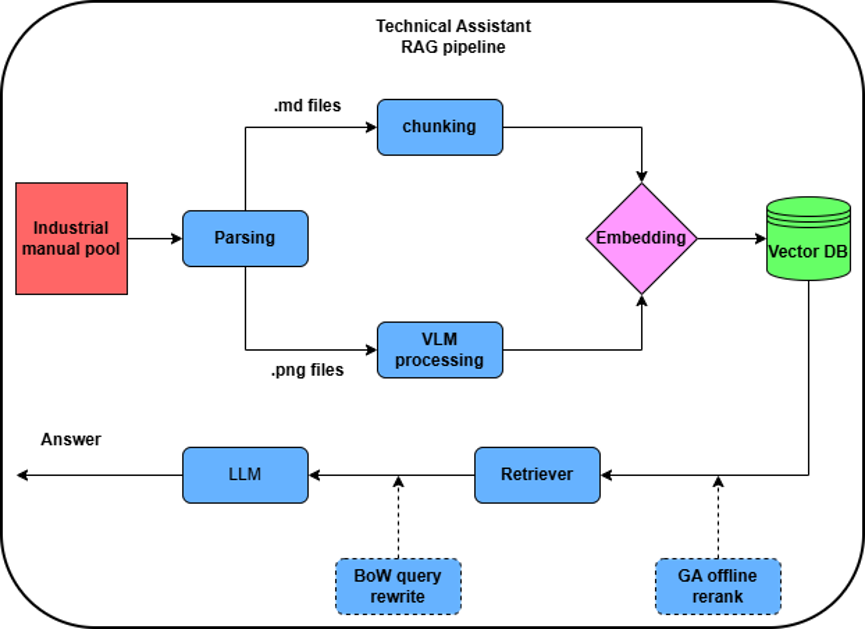
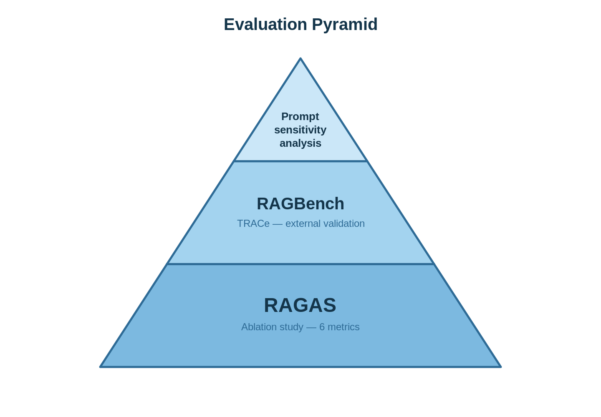

# Advanced RAG for Industrial Manuals

A local Retrieval-Augmented Generation (RAG) system for asking questions about industrial equipment manuals (CNC machines, excavators, lathes, presses, etc.). PDFs are converted into text and vision-described chunks, indexed in ChromaDB, retrieved with a **Genetic-Algorithm-optimised reranker**, and answered by a local LLM through Ollama — all through a Streamlit chat interface.

## Features

- **Hybrid text + vision ingestion** — page text is chunked and embedded; pages containing diagrams or graphics are rendered and described by a vision-language model, so schematics and tables become searchable.
- **GA-optimised reranking** — a genetic algorithm learns how to weight five relevance signals (cosine similarity, BM25, diversity, position, query coverage) and how many chunks to keep (`top_k`). At query time the learned weights are applied instantly; no GA runs during inference.
- **Optional query rewriting** — the v3 retriever rewrites each question into several variants, guided by the most discriminative corpus terms from a BM25 bag-of-words index.
- **Page-level citations** — every chunk carries its source PDF and page number.
- **Fully local inference** — embeddings and generation run on your machine; only the evaluation scripts call OpenAI.
- **Evaluation tooling** — RAGAS evaluation on a custom question set and TRACe evaluation on three RAGBench subsets.

## How it works


### Retriever versions

| File | Pipeline | Role |
|------|----------|------|
| `rag_retriever_base.py` | Single cosine-similarity search, instruction-only prompt | Baseline / control |
| `rag_retriever_v2.py` | Cosine search → GA reranking | **Used by the app** |
| `rag_retriever_v3.py` | Multi-query rewriting with BM25 vocabulary → merged search → GA reranking | Ablation arm |

All three expose the same interface: `retrieve()`, `generate_answer()`, `query()`, `list_sources()`, `count()`.

### GA reranker

The reranker (`ga_reranker/`) scores each candidate chunk as a weighted sum of five criteria. The chromosome encodes those five weights plus `top_k` (3–15). Fitness on an annotated ground-truth set is

```
fitness = 0.3·NDCG + 0.2·Precision + 0.3·Recall + 0.2·MRR
```

The GA engine follows Dao, Abhary & Marian (2017), *"An innovative framework for designing genetic algorithm structures"*: adaptive restarting when the search stagnates, local solution generation around the best chromosome, and elitism.

## Repository structure

```
├── app.py                     # Streamlit UI: upload/queue manuals, chat, delete sources
├── config.py                  # Paths, model names, chunking and GA settings
├── rag_preprocessor.py        # RAGPreprocessor: PDF → text/vision chunks → ChromaDB
├── rag_retriever_base.py      # Baseline retriever
├── rag_retriever_v2.py        # Retriever with GA reranking (default)
├── rag_retriever_v3.py        # Retriever with BM25-guided query rewriting + GA reranking
├── bm25_bow.py                # Builds the BM25 bag-of-words index (data/bow.json)
├── ga_reranker/               # GA reranker package used at inference time
├── generate_eval_dataset.py   # Generates Q&A pairs from indexed chunks with the local LLM
├── rag_evaluation.ipynb       # RAGAS evaluation of the pipeline
├── ragbench_eval.py           # TRACe evaluation on RAGBench (emanual, delucionqa, techqa)
├── Genetic-Algorithm-RAG/     # GA training project
│   ├── ground_truth_annotator.py   # Interactive tool to label relevant chunks per question
│   ├── dataset_creator.ipynb       # Builds the annotated ground-truth dataset
│   ├── ga_final.ipynb              # Trains the GA reranker and plots convergence
│   └── ga_reranker/                # Training-time copy of the reranker package
├── requirements.txt
└── start_app.bat              # Windows launcher (activates venv, starts Streamlit)
```

The `data/` folder (manuals, chunks, images, vector database, weights) and all evaluation results are not included in the repository. `config.py` creates the data folders automatically on first run.

## Requirements

- Python 3.12
- [Ollama](https://ollama.com/) running locally on `localhost:11434`
- A GPU is strongly recommended (the default generation model is 27B parameters)
- An OpenAI API key — only for `rag_evaluation.ipynb` and `ragbench_eval.py`

## Installation

```bash
git clone https://github.com/Tranr03/Advanced-Rag-for-industrial-manuals.git
cd Advanced-Rag-for-industrial-manuals

python -m venv venv
venv\Scripts\activate          # Windows
# source venv/bin/activate     # Linux / macOS

pip install -r requirements.txt
# extra packages used by the evaluation and annotation scripts
pip install openai openpyxl matplotlib
```

Pull the Ollama models:

```bash
ollama pull qwen3.5:27b
ollama pull qwen3-vl:8b
```

`config.py` sets `HF_HUB_OFFLINE=1`, so the embedding model must already be in the local Hugging Face cache. On the first run, download it once:

```bash
python -c "from sentence_transformers import SentenceTransformer; SentenceTransformer('BAAI/bge-base-en-v1.5')"
```

(If that fails with an offline error, run it with the environment variable `HF_HUB_OFFLINE=0`.)

### GA weights

`rag_retriever_v2.py` and `rag_retriever_v3.py` load the trained reranker weights from `data/ga_weights.json`. Train them with `Genetic-Algorithm-RAG/ga_final.ipynb` (output: `Genetic-Algorithm-RAG/trained_weights/best_weights.json`) and copy the file to `data/ga_weights.json`. The file has this format:

```json
{"w_cosine": 0.2, "w_bm25": 0.2, "w_diversity": 0.2, "w_position": 0.2, "w_coverage": 0.2, "top_k": 5}
```

## Usage

### Run the app

```bash
streamlit run app.py
```

or double-click `start_app.bat` on Windows. Then open http://localhost:8501.

1. Upload one or more PDF manuals in the sidebar and click **Process Queue**. Already-indexed manuals are skipped.
2. Optionally pick a single manual to search in.
3. Ask questions in the chat. Answers come with the source pages that were used.

### Use the pipeline from Python

```python
from rag_preprocessor import RAGPreprocessor
from rag_retriever_v2 import RAGRetriever
from config import MANUALS_FOLDER

pre = RAGPreprocessor()
pre.process_all(MANUALS_FOLDER)                 # index every PDF in data/manuals/

rag = RAGRetriever(embedding_model=pre.embedding_model, collection=pre.collection)
answer, docs = rag.query("What is the maximum spindle speed?")
print(answer)
for d in docs:
    print(d["metadata"]["source"], "p.", d["metadata"]["page"])
```

### Build the BM25 vocabulary (needed by v3)

```bash
python bm25_bow.py --input data/markdown_temp --output data/bow.json
```

## Evaluation

Set your OpenAI key first:

```bash
setx OPENAI_API_KEY "sk-..."      # Windows (open a new terminal afterwards)
export OPENAI_API_KEY="sk-..."    # Linux / macOS
```

**Custom question set (RAGAS)**

```bash
python generate_eval_dataset.py --per-source 5   # writes data/evaluation_questions.xlsx
```

Then run `rag_evaluation.ipynb`. It runs the chosen retriever on every question and scores the answers with RAGAS: faithfulness, answer relevancy, context precision/recall, answer correctness and answer similarity.

**RAGBench (TRACe)**

`ragbench_eval.py` builds a separate ChromaDB collection per dataset (the production `rag_manuals` collection is never touched), runs the v2 pipeline on the test split, and uses GPT-4o as the TRACe annotator.

```bash
python ragbench_eval.py --stage retrieve --datasets emanual --limit 5   # smoke test, no API cost
python ragbench_eval.py --stage all                                    # full run (paid GPT-4o calls)
```

Stages: `index`, `retrieve`, `evaluate`, `all`. Results are written to `data/ragbench_results/` as JSON and Excel.

## Configuration

All main settings live in `config.py`:

| Setting | Default |
|---------|---------|
| `EMBEDDING_MODEL` | `BAAI/bge-base-en-v1.5` |
| `OLLAMA_MODEL` | `qwen3.5:27b` |
| `VISION_MODEL` | `qwen3-vl:8b` |
| `CHUNK_SIZE` / `CHUNK_OVERLAP` | `800` / `80` |
| `GA_RETRIEVAL_POOL` | `50` candidates (must match training) |
| `COLLECTION_NAME` | `rag_manuals` |

GA hyperparameters (population, crossover/mutation rates, generations, fitness weights) are in `ga_reranker/config.py`.

## References

- Dao, S. D., Abhary, K., & Marian, R. (2017). An innovative framework for designing genetic algorithm structures. *Expert Systems with Applications*, 90, 196–208.
- Friel, R., Belyi, M., & Sanyal, A. (2024). RAGBench: Explainable Benchmark for Retrieval-Augmented Generation Systems. arXiv:2407.11005.
- Es, S., James, J., Espinosa-Anke, L., & Schockaert, S. (2023). RAGAS: Automated Evaluation of Retrieval Augmented Generation. arXiv:2309.15217.
